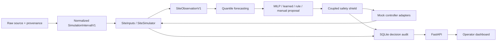

# Integrated local simulation application

The application extends Devansh's existing Python package. Models, shield, adapters,
backend, and dashboard share the versioned contracts under `contracts/`. Power is
**MW**, energy **MWh**, price **USD/MWh**, temperature **°C**, timestamps **UTC**.
Battery positive means discharge; grid positive means import. There is no second
application or hardware integration.



`Dispatcher` remains the orchestration boundary. The shield checks current state,
time binding, telemetry quality, equipment availability, battery energy/power/ramp,
generator commitment/ramp, compute capacity, cooling lag/ramp, grid import/export,
and coupled bus/temperature feasibility. Modified actions retain the complete
original proposal and exact changed fields. Infeasible/invalid requests reject.
The adapter independently rechecks authorization before atomically preparing five
mock controllers and advancing the same simulator. Surrogates provide advisory
predictions only. Low-level physics/Gym entry points remain available for physical
model tests; they are not operational APIs.

## Install

Python 3.10–3.12 on Linux/macOS (Windows via WSL); no credentials or external data needed for the synthetic workflow.

```bash
python3 -m venv .venv
source .venv/bin/activate
python -m pip install -c requirements-dev.lock -e '.[dev]' build
```

`ml`, `service`, `optimizer`, `data`, `sim`, `all`, and `browser` extras support narrower
installs. `dev` includes all application and unit-test dependencies; `browser`
additionally installs Playwright (browser binaries are a separate download).

## Complete demo

```bash
python -m energy_decision_layer demo --steps 24 --output artifacts/demo
```

The first run trains missing models on explicitly labelled synthetic data, then
runs changing demand/price/weather, battery charging/discharging, a constrained
grid, generator startup/ramp, and a deliberately unsafe manual proposal. Baseline
and learned proposals use the same safety/adapter/simulator/logging path. It checks
actual state/history/metrics APIs and writes `demo.json` plus persistent SQLite
records. Use a new output directory for another independent run.

To open the operator console with trained models:

```bash
python -m energy_decision_layer serve --models artifacts/models \
  --database artifacts/operator.sqlite3 --steps 288
```

Open **http://127.0.0.1:8000**; API explorer at `/docs`. Serving uses one worker.
The simulator pauses between commands. Commands advance one five-minute interval;
wall-clock timestamps on the synthetic episode do not imply live sensor freshness.

## Data and model training

```bash
# Existing immutable raw -> validated JSONL/Parquet pipeline
python -m energy_decision_layer etl examples/synthetic.csv --synthetic --output artifacts/etl
# A larger, labelled synthetic normalized training dataset
python -m energy_decision_layer synthetic --steps 2016 --seed 7 --output artifacts/synthetic.jsonl
# All components, with reproducible seed and optional search configuration
python -m energy_decision_layer train-all --data artifacts/synthetic.jsonl \
  --seed 7 --config configs/training.json --output artifacts/models
# Or train components separately (same --data / --seed / --output options)
python -m energy_decision_layer train-forecast --data artifacts/synthetic.jsonl
python -m energy_decision_layer train-policy --data artifacts/synthetic.jsonl
python -m energy_decision_layer train-surrogates --data artifacts/synthetic.jsonl
```

Omitting `--data` generates a seven-day synthetic training fixture. Actual input
must use `SimulationIntervalV1` JSONL, one site/cadence, UTC, contiguous intervals,
and explicitly converted USD prices. The existing ETL's small example has too few
rows for training. See [data sources](DATA_SOURCES.md) for real-source access,
licensing and mappings; no real data is bundled or implied by synthetic results.
Run `serve --data PATH` to replay a normalized dataset with its site/cadence/start.

Model artifacts and training/evaluation metadata are generated under ignored
`artifacts/`. Forecast and surrogate pickle files must come from a trusted local
training run; loading untrusted pickle files can execute code. Checkpoints include
model versions, seed, training configuration and data/calibration information.
A missing forecast model/history yields an explicitly labelled persistence
fallback with uncertainty. Learned control is unavailable without a checkpoint.
A learned checkpoint must match site configuration. [ML methodology](ML.md)
describes chronological splits, empirical intervals, the CEM learned controller,
surrogate targets, and limitations.

## Authorization and environment

| Variable | Default / meaning |
|---|---|
| `EDL_CONTROL_MODE` | `simulation`; any other value is rejected |
| `EDL_OPERATOR_TOKEN` | Unset; bearer token allowing simulated dispatch and manual override |
| `EDL_DISPATCHER_TOKEN` | Unset; distinct bearer token allowing simulated policy dispatch |
| `EDL_EVALUATION_DIR` | `artifacts/ml-evaluation`; saved reports displayed by the dashboard |
| `EDL_DB_PATH` | `artifacts/decisions.sqlite3` when constructing the API directly |

CLI database/model paths are explicit flags. No token grants physical control.
Without tokens the dashboard is read-only and execution controls are disabled.
For optional local controls, create independent random values in your shell's
environment and enter one in the dashboard's password field. Tokens remain in
browser memory, are not stored in localStorage, and are not part of decision logs.
Observer access cannot execute actions; dispatcher access cannot override them.
The default loopback server is intended for local development.

## API and audit semantics

Read endpoints: `/api/state`, `/api/telemetry`, `/api/forecasts`,
`/api/forecast-status`, `/api/recommendations/{rule|baseline|learned}`,
`/api/decisions`, `/api/metrics`, `/api/evaluation`, `/api/policies`, `/health`, `/ready`.

`POST /api/safety/validate` previews an action without execution.
`POST /api/dispatch` accepts `{"policy":"baseline"}` and a bearer token.
`POST /api/manual-overrides` (also `/api/actions`) requires the operator token
and a full proposed-action contract; preview a recommendation for a current template.
Every executing request requires a unique `Idempotency-Key` header. Repeating an
identical request returns its original result without advancing time. Reusing a
key for different input fails. Policy selection alone never executes an action.

SQLite migrations live alongside the service. Decisions record state, forecasts,
versions, proposing policy, original request, shield response/final action and
execution outcome. A committed outcome includes telemetry, checkpoint and request
result in one transaction. Restarts resume committed simulator state. An unresolved
request fails closed, including after a possible applied action with failed outcome
audit: inspect the audit and recover deliberately; never blindly retry actuation.
Use a new database for a different scenario. There is no unsupported real-hardware
retry or automatic assumption that a rejected command succeeded.

## Evaluation and checks

```bash
python -m energy_decision_layer evaluate-ml --models artifacts/models --steps 24
python -m pytest -q --cov=energy_decision_layer --cov-report=term-missing
python -m ruff check src tests examples
python -m ruff format --check src tests examples
python -m mypy src/energy_decision_layer
node --check src/energy_decision_layer/service/static/app.js
python -m build
# Real Chromium + actual uvicorn backend, UI/API cross-check, mobile and error states
python -m pip install -c requirements-dev.lock -e '.[browser]'
python -m playwright install --with-deps chromium
python examples/browser_smoke.py --models artifacts/models --output artifacts/browser-smoke
```

The dashboard is buildless HTML/CSS/JavaScript packaged in the Python wheel; it has
no Node dependency installation or framework bundler. Python package build and
JavaScript syntax/browser tests validate its distributable assets.

Evaluation reuses existing scenarios, economics and metrics, adds grid/thermal
violation counts and fuel, persists decision traces, and compares rule/MILP/learned
control plus ±25% prospective forecast-bias experiments. JSON/CSV/Markdown outputs
include failed runs and terminal states. The rolling perfect-hindsight MILP is
explicitly not a proven episode optimum. A separately documented, independently
solvable one-step case reports valid exact regret. No baseline superiority claim
is made. Default training has synthetic site physics, demand and stress labels.

## Limits and future work

This is a working simulation application, not a certified protection system.
Telemetry/physics parameters need real-site calibration; SOH is a throughput-wear
proxy because no ageing labels exist. Prediction interval coverage is empirical,
not guaranteed under shifts or recursive horizons. CEM searches a small controller,
not a general RL agent. Impossible electrical/thermal states intentionally stop
and require local protection. Real telemetry fusion, controller-specific hardware
protocols, enterprise identity, calibrated uncertainty and production deployment
remain outside this offline implementation. Do not infer production readiness or
real-world savings from synthetic benchmark scores.
